# 🌐 Awesome Decentralized Social Networks

    

**A definitive, curated landscape of decentralized social networks, federated communication protocols, open-source community platforms, and self-hosted Web3/Fediverse ecosystems.**

*Empowering developers, community builders, privacy advocates, and organizations to reclaim sovereign identity and distributed social graphs.*

🕒 **Last updated: October 2026**

---

## 🧭 Table of Contents

- [📊 Sector Overview & Market Dynamics](#-sector-overview--market-dynamics)
- [💼 SaaS/Hosted Platforms](#-saashosted-platforms)
- [🔓 Open-Source GitHub Projects](#-open-source-github-projects)
  - [⭐ Ranked Open-Source Projects (by Stars)](#-ranked-open-source-projects-by-stars)
  - [🧩 Protocols & Independent Open-Source Platforms](#-protocols--independent-open-source-platforms)
- [🤝 How to Contribute](#-how-to-contribute)
- [💖 Support](#-support)
- [📈 Star History](#-star-history)
- [⚖️ Disclaimer](#-disclaimer)

---

## 📊 Sector Overview & Market Dynamics

The global dedicated online community and enterprise social network platform market is estimated at approximately **$1.5B to $2.2B** (projected to exceed **$5B+ by 2032** at an 11–13% CAGR), while the broader consumer social networking advertising ecosystem surpasses **$150B+**. 

The sector exhibits a clear **bifurcated market structure**:
1. **The Consumer Social Layer**: Highly concentrated and dominated by winner-take-most advertising monopolies (Reddit, Meta, X) driven by massive centralized network effects and proprietary data locking.
2. **The Community Software & SaaS Layer**: Moderately-to-highly fragmented across creator communities, enterprise support portals, and self-hosted open-source software. 

A growing movement toward **data sovereignty, federated protocols (ActivityPub, ATProto, Nostr, Matrix), and regulatory anti-monopoly pressures** is rapidly driving communities toward self-hosted and federated alternatives where operators own their social graph, moderation policies, and member identity.

---

## 💼 SaaS/Hosted Platforms

| Product | Company Size (Valuation / Revenue) | Starting Tier Pricing | Free Tier / Trial Limits | Description |
| :--- | :--- | :--- | :--- | :--- |
| **Reddit** | ~$30B–$35B market cap ($2.2B FY2025 revenue) | $0 (Ad-supported user model); Reddit Premium starts at $5.99/mo | Free forever plan with full access to browse, post, and create communities (ad-supported; API subject to standard free tier rate limits: 100 queries/min) | 🌐 The centralized link aggregator standard. Fully proprietary and cloud-hosted. **No federation, no self-hosting**—the platform operator controls moderation policy, API access, and data. Best for communities prioritizing maximum audience reach over data sovereignty. |
| **Khoros Communities** | ~$250M–$284M annual revenue (Acquired by IgniteTech, private) | Starts at ~$50,000/year (~$4,166/mo entry mid-market/enterprise contract) | No free tier or public self-serve trial (requires a scheduled sales-assisted demo) | 🏢 Enterprise community and customer engagement platform. Fully proprietary and cloud-hosted. **No federation or self-hosting**—ideal for global enterprises requiring unified brand care, CRM integrations, and compliance. |
| **Circle.so** | ~$55M–$68M ARR ($33M+ funding, private) | $89/mo (billed annually) or $99/mo (billed monthly) on Professional Plan | 14-day free trial on Professional and Business plans (full feature access, up to 3 admins and 10 moderators; no credit card required) | 🎨 Centralized community platform for creators and businesses. Fully proprietary and cloud-hosted. **No federation or self-hosting**—engineered for creators wanting polished discussions, paywalls, and courses in one hub. |
| **Discourse (Hosted)** | ~$10M–$15M ARR (Private) | $0/mo (Free Managed Plan); Paid managed plans start at $100/mo (Standard) | Free forever managed plan hosted on `.discourse.group` subdomain (limited to 2 staff seats, 5GB storage, 20,000 monthly emails, and community plugin set) | 💬 **Official managed hosting** for Discourse forums. Features **business-class hosting** with automatic upgrades, backups, and support. **Note**: The core software is open source (GPL-2.0)—hosting is a managed convenience service. |
| **Mighty Networks** | ~$8M–$10M annual revenue (~$100M–$250M valuation, private) | $79/mo (billed annually) or $95/mo (billed monthly) on Launch Plan ($29/mo on Explore Plan) | 14-day free trial with full Growth Plan features (unlimited members, events, spaces, and course creation testing; no credit card required) | 🚀 Centralized community and course platform. Fully proprietary and cloud-hosted. **No federation or self-hosting**—best for educators and brands monetizing content, cohort courses, and discussions. |

---

## 🔓 Open-Source GitHub Projects

Explore the leading decentralized, federated, and self-hosted social networking solutions. All repositories below are **strictly sorted in descending order by GitHub Star count**.

### ⭐ Ranked Open-Source Projects (by Stars)

1. ### **Mastodon** 
   - **Repository**: [mastodon/mastodon](https://github.com/mastodon/mastodon) *(License: AGPL-3.0)*
   - **Category**: Federated Microblogging & Social Streaming
   - **Overview**: The flagship server and web UI for the Fediverse, powered by the W3C ActivityPub protocol. Allows independent communities to federate seamlessly without vendor lock-in. Features real-time chronological feeds, comprehensive anti-abuse/moderation toolkits, media attachments, and rich REST/Streaming APIs. Mastodon 4.6+ introduces native newsletter broadcasting and curated lists, serving as the benchmark for open social graph interoperability.

2. ### **Discourse** 
   - **Repository**: [discourse/discourse](https://github.com/discourse/discourse) *(License: GPL-2.0)*
   - **Category**: Long-Form Community Discussion & Modern Forums
   - **Overview**: The gold standard for modern, long-form discussion forums. Built on Ruby on Rails and Ember.js with PostgreSQL and Redis. Highlights include dynamic endless scrolling, flattened conversational threading, trust-level progression, and self-learning community moderation. Recent versions pack built-in Model Context Protocol (MCP) servers and AI dashboards to assist community managers with automated summarization.

3. ### **PeerTube** 
   - **Repository**: [Chocobozzz/PeerTube](https://github.com/Chocobozzz/PeerTube) *(License: AGPL-3.0)*
   - **Category**: Federated Peer-to-Peer Video Streaming & Podcasting
   - **Overview**: Developed by Framasoft, PeerTube is the decentralized, ActivityPub-based alternative to YouTube. It employs WebTorrent and WebRTC for browser-based peer-to-peer video distribution, dramatically slashing server bandwidth costs. Supports live streaming with chat, video transcoding, multi-channel management, and cross-server federation.

4. ### **NodeBB** 
   - **Repository**: [NodeBB/NodeBB](https://github.com/NodeBB/NodeBB) *(License: GPL-3.0)*
   - **Category**: Real-Time WebSockets Forum Software
   - **Overview**: Next-generation forum software written in Node.js supporting MongoDB, Redis, and PostgreSQL backends. Leverages real-time WebSockets for instantaneous comment streaming, mentions, and notifications. With native ActivityPub plugins, NodeBB instances can federate directly into the Fediverse, allowing remote Mastodon users to reply to forum topics.

5. ### **Lemmy** 
   - **Repository**: [LemmyNet/lemmy](https://github.com/LemmyNet/lemmy) *(License: AGPL-3.0)*
   - **Category**: Federated Link Aggregation & Threaded Discussion
   - **Overview**: The premier Rust-based federated alternative to Reddit. Forms the backbone of the "Threadiverse" alongside Mbin and PieFed. Features aggregate vote scores (+/-), live comment updates, multi-theme UI, fast arm64/Raspberry Pi hosting, and federated community subscriptions across hundreds of independent server instances.

6. ### **Diaspora\*** 
   - **Repository**: [diaspora/diaspora](https://github.com/diaspora/diaspora) *(License: AGPL-3.0)*
   - **Category**: Distributed Privacy-Aware Social Network
   - **Overview**: A pioneer of privacy-aware distributed social networking. Built around the concept of independent "pods" connected via the Diaspora protocol, enabling users to organize relationships into discrete "Aspects" (family, work, friends) so updates are shared strictly with chosen audiences without corporate tracking.

7. ### **Nostr Protocol** 
   - **Repository**: [nostr-protocol/nostr](https://github.com/nostr-protocol/nostr) *(License: Public Domain)*
   - **Category**: Decentralized Relays & Cryptographic Notes
   - **Overview**: **N**otes and **O**ther **S**tuff **T**ransmitted by **R**elays—an ultra-minimalist, censorship-resistant, decentralized communication protocol based on Schnorr cryptographic signatures and lightweight JSON relays over WebSockets. Users maintain their identity via public/private keys without servers, email verification, or central gatekeepers.

8. ### **Matrix Synapse**  
   - **Repository**: [matrix-org/synapse](https://github.com/matrix-org/synapse) *(License: AGPL-3.0)*
   - **Category**: Federated Real-Time Communication & Spaces
   - **Overview**: The reference homeserver implementation for Matrix, the open standard for secure, decentralized, end-to-end encrypted messaging, voice, video, and community "Spaces". Matrix bridges to Slack, Discord, IRC, and Signal, providing decentralized real-time group collaboration.

9. ### **Owncast** 
   - **Repository**: [owncast/owncast](https://github.com/owncast/owncast) *(License: MIT)*
   - **Category**: Self-Hosted Live Video Streaming & Social Chat
   - **Overview**: The open-source, self-hosted alternative to Twitch. Packed with built-in Fediverse integration via ActivityPub, allowing users across Mastodon and other platforms to follow your live stream, get notified when you go live, and interact directly in the stream chat.

10. ### **Misskey** 
    - **Repository**: [misskey-dev/misskey](https://github.com/misskey-dev/misskey) *(License: AGPL-3.0)*
    - **Category**: Feature-Rich Federated Microblogging & Widgets
    - **Overview**: An expressive, dynamic ActivityPub microblogging platform created in Japan with TypeScript and Vue.js. Renowned for custom emoji reactions, customizable UI widgets, antenna search feeds, built-in mini-games, and rich drive storage capabilities.

11. ### **Bluesky ATProto** 
    - **Repository**: [bluesky-social/atproto](https://github.com/bluesky-social/atproto) *(License: Apache-2.0 / MIT)*
    - **Category**: Authenticated Transfer Protocol & Decentralized Social Graphs
    - **Overview**: The core specifications and reference code powering Bluesky. ATProto introduces cryptographic account portability (DID-based identities), algorithmic choice with custom user-selectable feeds, and federated Personal Data Servers (PDS), separating hosting from the global indexing relay.

12. ### **Pixelfed** 
    - **Repository**: [pixelfed/pixelfed](https://github.com/pixelfed/pixelfed) *(License: AGPL-3.0)*
    - **Category**: Federated Photo & Media Sharing (Instagram Alternative)
    - **Overview**: The ethical, privacy-focused visual sharing platform for the Fediverse. Offers photo filters, stories, collections, direct messaging, multi-factor authentication, and zero algorithmic manipulation or advertisement surveillance.

13. ### **Flarum** 
    - **Repository**: [flarum/framework](https://github.com/flarum/framework) *(License: MIT)*
    - **Category**: Lightweight Modern Discussion Engine
    - **Overview**: Delightfully simple and fast forum software built with modern PHP and Mithril.js. Requires a tiny server footprint (~256 MB RAM) compared to heavy enterprise alternatives. Boasts an ecosystem of 1,600+ community extensions for OAuth, SSO, gamification, and SEO.

14. ### **Friendica** 
    - **Repository**: [friendica/friendica](https://github.com/friendica/friendica) *(License: AGPL-3.0)*
    - **Category**: Multi-Protocol Universal Social Communications Bridge
    - **Overview**: The federation champion of the decentralized web (operating since 2010). Bridges ActivityPub, Diaspora, DFRN, OStatus, email (IMAP/SMTP), and RSS into a unified social feed with Facebook-style profile circles, events, RSVP systems, and granular per-post privacy controls.

15. ### **Mbin** 
    - **Repository**: [MbinOrg/mbin](https://github.com/MbinOrg/mbin) *(License: AGPL-3.0)*
    - **Category**: Federated Microblogging & Link Aggregation (Kbin Evolution)
    - **Overview**: An open-source, federated discussion platform created by the community as the successor to Kbin. Written in PHP/Symfony, it unites Reddit-style forum posts, link aggregation, and microblog feeds on ActivityPub.

---

### 🧩 Protocols & Independent Open-Source Platforms

*Projects hosted on Codeberg, FramaGit, and independent decentralized code forges:*

- **GoToSocial** ([Codeberg: superseriousbusiness/gotosocial](https://codeberg.org/superseriousbusiness/gotosocial)) *(License: AGPL-3.0)*  
  ⚡ Written in Go, GoToSocial provides a minimalist, lightning-fast personal ActivityPub microblogging server. Consumes negligible server memory (~50–100MB), making it ideal for hosting your personal Fediverse identity on a Raspberry Pi or low-cost VPS.
- **PieFed** ([Codeberg: rimu/pyfedi](https://codeberg.org/rimu/pyfedi)) *(License: AGPL-3.0)*  
  🥧 A Python-based link aggregator and forum for the Threadiverse. Offers Lemmy/Reddit compatibility with alternate UI paradigms, customizable moderation queues, and lightweight resource requirements.
- **Hubzilla** ([FramaGit: hubzilla/core](https://framagit.org/hubzilla/core)) *(License: MIT)*  
  🛡️ The pioneer of nomadic identity via the Zot/Nomad protocol alongside ActivityPub. Enables your account, contacts, and posts to be cloned across redundant hubs—if your primary server vanishes, your decentralized identity survives uninterrupted.
- **Discourse AI** — Official AI integration plugin for Discourse, providing vector semantic search, post summarization, and moderation automation.
- **Lemmy UI** — The modular, ~80kB gzipped front-end client written in inferno-js for Lemmy servers.

---

## 🤝 How to Contribute

Contributions are warmly encouraged! Help us maintain the most comprehensive directory of decentralized social networks:

1. 🍴 Fork the repository.
2. 📝 Add or update an entry in `README.md` following the established formatting guidelines.
3. 🔗 Verify that all project links, GitHub star badges, licenses, and official websites are valid and accurate.
4. 🚀 Submit a Pull Request with a clear, concise description of your additions.

---

## 💖 Support

If this curated decentralized social ecosystem tracker has helped you explore the Fediverse or architect sovereign community infrastructure, please consider supporting continued maintenance:

- ⭐ **Star this repository** on GitHub to amplify its reach!
- 🍴 **Fork and share** with fellow developers, privacy advocates, and community managers.
- ☕ **Sponsor the Maintainer**: Support ongoing open-source research and directory curation via the [GitHub Sponsors Dashboard](https://github.com/sponsors/ishandutta2007).

---

## 📈 Star History

---

## ⚖️ Disclaimer

- This is an **independent, community-curated list** provided for educational and architectural research purposes. It does not constitute an endorsement.
- Decentralized networks handling user content and identities should be rigorously assessed for **moderation governance**, **metadata leakage across relays**, **encryption models**, and **long-term server viability**.
- **Link Aggregators vs. Microblogging**: Lemmy, Mbin, and PieFed prioritize community-based upvoting and threaded discussions ("Threadiverse"), whereas Mastodon and Misskey prioritize chronological microblog feeds. Choose based on whether your community needs broadcasts or forum conversations.
- **Operational Overhead**: Self-hosting federated nodes grants complete data sovereignty, but administrators assume responsibility for automated backups, spam mitigation, media storage caching, and federation blocklists.

---

**Made with ❤️ for community managers, privacy advocates, and builders of the sovereign web.**

